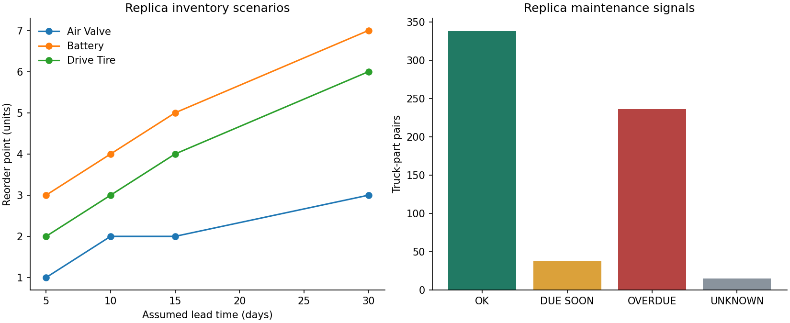
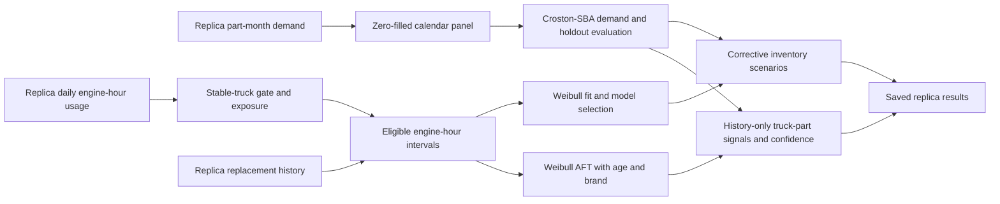

# Fleet Maintenance and Inventory Optimization

How can spare-parts demand and engine-hour usage support inventory scenarios and maintenance attention?

Built on a company's real operating data. Under a confidentiality agreement, the numbers shown come from a masked replica that keeps the data's shape, not its values.

**Replica results:** the reproduction command produces **156 inventory-policy rows** for **39 corrective parts** and **627 historical truck–part signals**: 338 OK, 38 DUE SOON, 236 OVERDUE and 15 UNKNOWN. Planners can inspect stock scenarios alongside elapsed engine-hour intervals and confidence tiers.

[](https://github.com/diegomadriz/fleet-maintenance-inventory/actions/workflows/ci.yml)
[](LICENSE)



## How it works

The project connects maintenance demand and engine-hour usage for a fleet of 100+ mixer trucks. This command reads masked replica tables and runs the demand and reliability models locally, producing tables and a figure. Built in a multidisciplinary student team project; this repository contains the data pipeline and models.



Croston-SBA smooths positive demand size and inter-demand timing separately, retaining zero months. Weibull uses replacement intervals on the engine-hour clock; estimated history enters reliability fits only for trucks with stable utilization. AFT adds age and brand effects, with sparse-history fallbacks. Min-max policy combines expected demand over an assumed lead time, a variability allowance and review-period demand. Scenarios use a **95% service target** and **5, 10, 15 and 30 days** of assumed lead time; these are scenario settings.

Inventory policy covers corrective parts with positive in-calendar demand. Parts without that demand have no policy rows, even if they have earlier replacement history. A separate Croston evaluation covers the whole replica catalogue. Full-calendar forecasts feed inventory; training-prefix forecasts feed holdout evaluation. The original unpenalized AFT fitting, unbounded interval prediction and fallback behavior are preserved; [model decisions](docs/model-decisions.md) explain the formulas and explicit input substitutions.

## Replica results

All rows below come from this repository's command. [Summary](results/summary.json), [complete inventory table](results/inventory_policy.csv), [interval lookup](results/maintenance_intervals.csv), [truck–part schedule](results/maintenance_schedule.csv) and [fit parameters](results/model_parameters.csv) provide the detailed outputs.

| Replica metric | Value |
|---|---:|
| Parts evaluated (whole catalogue) | 54 |
| Corrective parts modeled (positive calendar demand) | 39 |
| Inventory-policy rows | 156 |
| Historical truck–part signals | 627 |
| Schedule status counts — DUE SOON | 38 |
| Schedule status counts — OK | 338 |
| Schedule status counts — OVERDUE | 236 |
| Schedule status counts — UNKNOWN | 15 |
| Confidence counts — ESTIMATED | 146 |
| Confidence counts — HIGH | 228 |
| Confidence counts — LOW | 44 |
| Confidence counts — MEDIUM | 194 |
| Preferred model counts — Croston-SBA | 22 |
| Preferred model counts — Weibull | 17 |
| AFT model counts — AFT | 17 |
| AFT model counts — no_fit | 20 |
| Demand class counts — erratic | 6 |
| Demand class counts — lumpy | 36 |
| Demand class counts — smooth | 5 |

Confidence counts cover pairs with an interval; UNKNOWN pairs have no confidence tier. Demand-class counts omit parts without sufficient positive months for classification. The brand/year interval lookup does not assign parts to trucks: final signals require a recorded replacement for the truck–part pair.

Croston-SBA is evaluated on **54 replica parts**, using **18 training months** followed by **6 holdout months**. The forecast is held fixed during the holdout. MAE and RMSE are in monthly-demand units. The [complete evaluation](results/croston_sba_evaluation.csv) includes every part; Generic part 05 is stored as `part-05` / `Other part 05` in the input taxonomy.

| Replica part | Demand class | Forecast (units/month) | Holdout MAE | Holdout RMSE |
|---|---|---:|---:|---:|
| Air valve | erratic | 2.7873 | 1.2624 | 1.3975 |
| Battery | lumpy | 6.1435 | 5.4768 | 5.5873 |
| Generic part 05 | lumpy | 2.4913 | 2.6609 | 2.8101 |

## Quickstart

Use Python 3.12, from the checkout root:

```bash
git clone https://github.com/diegomadriz/fleet-maintenance-inventory.git
cd fleet-maintenance-inventory
python3.12 -m venv .venv
source .venv/bin/activate
python -m pip install '.[dev]'
ruff check .
ruff format --check .
pytest -q
fleet-inventory --output out/reproduced
python tools/check_results.py out/reproduced
```

The reproduce command fits the models from the shipped replica and writes tables and a figure. The comparison checks all saved CSVs within numerical tolerances, the summary exactly, and the figure's presence. Tests cover model arithmetic, selection rules, zero-demand exclusion, schedule scope and CLI behavior; the optional generator is checked against all five shipped CSVs byte for byte. CI runs lint, formatting, tests and reproduction on Python 3.12. No credentials or private files are required. Dependencies are pinned in [pyproject.toml](pyproject.toml).

## Repository layout

```text
config/                 model settings and generator runtime assumptions
data/replica/           masked replica and coarse generator configuration
src/fleet_inventory/    model functions, pipeline, CLI and optional generator
results/                saved model outputs and figure
tests/                  numerical, source-formula, fidelity and CLI checks
tools/                  reproduction comparison
docs/                   data contract and modeling decisions
.github/workflows/      CI
```

The optional generator reads only local configuration and writes a separate exploration dataset. Model reproduction uses the shipped replica. See [data contract](docs/data-contract.md) for input grains and output meanings.

## Limitations

The replica selects Weibull for far more parts than the real project did: **a 42-percentage-point gap** compared with the original project's results, so its model mix is unrepresentative. That comparison covers a different population from this pipeline's active corrective-part counts above, and it doesn't establish real-data forecast or schedule equivalence.

Replacement-only Weibull fits exclude unfailed exposure and bias intervals short. The engine-hour demand approximation is not a renewal rate. Historical-hour reconstruction and incomplete observation coverage add uncertainty. Stock variability includes holdout months; Battery's holdout errors approach its forecast. Confidence tiers express sample depth and fallback source rather than measured predictive coverage. The original plain-Weibull fallback and unset age coefficient are documented in the model decisions.

Supplier lead times are assumed. Costs, balances, supplier constraints and ordering rules are absent. Real-data holdout-error agreement and model-ranking agreement have not been established. There is no threshold calibration, service-level validation or operational pilot; financial or downtime benefits are unmeasured.

MIT covers the code and the masked replica. See [LICENSE](LICENSE).

[Portfolio walkthrough](https://www.diegoramirezmadriz.dev/projects/fleet-maintenance-inventory-optimization) · [Model decisions](docs/model-decisions.md) · [Data contract](docs/data-contract.md)
